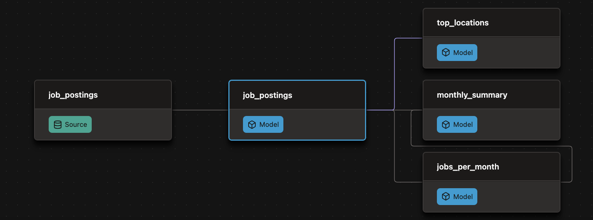

# Automated Job Postings Pipeline (v1) - dbt + DuckDB


A public dbt + duckDB pipeline over ~700K real job postings, rebuilt and republished automatically on every push

-   Models the raw postings into tested, documented insight marts
-   Publishes the docs site and finished warehouse - open to anyone, no credentials required

> **v1 of this pipeline** - everything free and local friendly: duckDB as warehouse, Github Actions as the scheduler. [v2](../project_2/) rebuilds its production grade on Databricks.


| What I built | How I Implemented | Where to look |
| :--- | :--- | :--- |
| **⚙️ dbt pipeline** | sources ➡️ cleaned model ➡️ insight marts | [`analytics/models/` →](analytics/models/) |
| **✅ Data Tests** | `unique` / `not_null` on every mart grain | [`schema.yml` →](analytics/models/schema.yml) |
| **Hosted dbt docs** | lineage, descriptions, column tests | [Live docs site](https://github.com/akashmihani/dbt-duckdb-pipeline/project1/) |
| **Public CI** | build + tests + publish on every push | [Actions workflow](https://github.com/akashmihani/dbt-duckdb-pipeline) |
| **Environments** | local `dev` vs CI `prod` targets | [ci/profiles.yml](ci/profiles.yml) |
| **Published warehouse** | one `ATTACH` queryable for everyone | [Query It](https://)


## ⚙️ The dbt Pipeline

Raw postings flow through three dbt layers -
declared sources ➡️ cleaned staging views ➡️ insight marts - with tests gating every build. The DAG below shows the high level flow:



And the dbt features doing the work:

| dbt feature | How I used It 
| --- | --- |
| **Declared sources (no hardcoded paths in code/SQL)** | [`sources.yml`](analytics/models/sources.yml) + `source('raw','job_postings')`
| **Model dependencies** | `ref()` everywhere downstream; dbt resolves order and parallelism
| **Materialization** | project default `table`; staging override to `view` 
| **✅ Data tests** | `unique/not_null` on mart grains in [`schema.yml`](analytics/models/schema.yml) |
| **Environments** | local `dev` vs CI `prod` targets ([`ci/profiles.yml`](ci/profiles.yml)) |

`dbt build` compiles SQL, materializes models, and fails the run if any test fails - same command locally and in CI.


## 🚀   Production 
GitHub Actions runs the whole pipeline - no laptop required. `.github/workflows/dbt_build.yml`

| **Trigger** | **What Happens**|
| --- | --- |
| Push to `main` | Full rebuild
|Weekly (Monday) | Scheduled rebuild - Pipelines stays fresh
| Manual `(Worklow_dispatch)` | Run below steps in the Action UI


On each run Actions:

1. Install deps with `uv`
2. Downloads raw parquet
3. Runs `dbt build` with the committed CI profile (prod)
4. Publishes `prod.duckDB` as Github Release asset

---

## ⚡ ⚡   Query the published warehouse ⚡ ⚡ 

No clone required. [Install DuckDB](https://duckdb.org/installation/) (`brew install duckdb`) then from a `duckDB` session:

```sql
INSTALL https;
LOAD httpfs;

ATTACH 'https://github.com/akashmihani/dbt-duckdb-pipeline/releases/download/warehouse/prod.duckdb' AS jobs;
USE jobs;
SHOW Tables;

Select * from top_locations;
Select * from jobs_per_month;
```

---


## 📖 Docs

Docs are generated with `dbt docs generate` and published to GitHub pages

**[]()

The site shows:

-   The full **lineage graph** (sources models marts)
-   **Model and column description** from the yaml files
-   which columns carry **tests**

## ▶️ ▶ 💻 Run it yourself

```bash
uv sync
uv run python scripts/download_data.py 
cd analytics && uv run dbt build
```

Optional docs locally

```bash
uv run dbt docs generate
uv run dbt docs serve
```